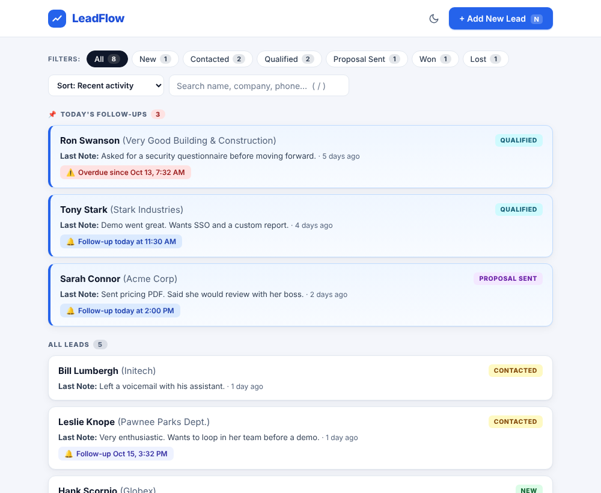
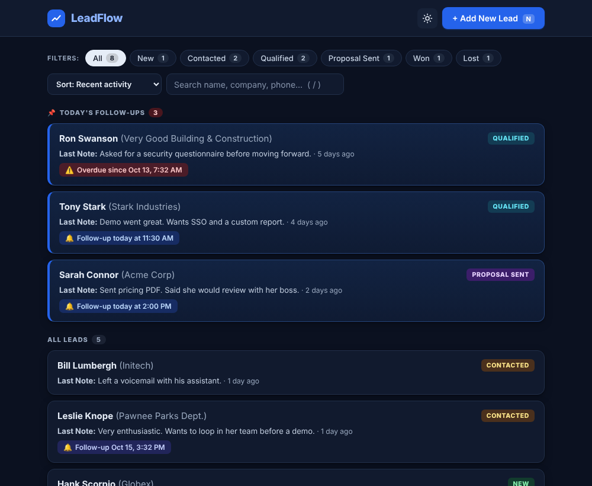
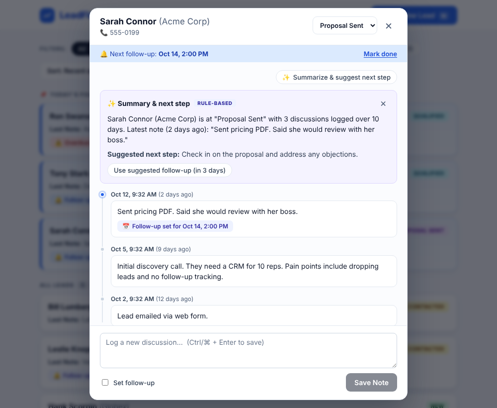

# LeadFlow

A single-screen lead manager: see every lead at a glance, log each conversation, and never miss a follow-up.
Built for the PravarAI full-stack intern assessment with **React (Vite) + Node.js (Express) + SQLite**.

**Live demo:** https://leadflow-n3ak.onrender.com/

| Light | Dark |
|---|---|
|  |  |



Everything happens on **one screen**: the lead list, and two dialogs on top of it (lead timeline, add lead). There are no other pages.

## Run it

Needs **Node 22.12+** (`nvm use` picks it up from `.nvmrc`; the server alone runs on Node 20+).

```bash
npm run install:all   # root + server + client dependencies
npm run dev           # API on :4000, web app on http://localhost:5173
```

On first start the database is created and filled with demo leads. Delete `server/data/` to reset it.

| Command | What it does |
|---|---|
| `npm run dev` | API + Vite dev server with hot reload |
| `npm start` | Build the UI and serve everything from Express on :4000 |
| `npm test` | Server tests, then client tests |
| `npm run test:tz` | Client tests again under three other timezones |
| `npm run docker` | `docker compose up --build`, then open http://localhost:4000 |

## What it does (mapped to the brief)

**1. Lead list**
- Name, company, status badge, last discussion note and how long ago it was written.
- Filter by All / New / Contacted / Qualified / Proposal Sent / Won / Lost, with live counts.
- **Today's follow-ups are pinned to the top.** Overdue ones on open leads are pinned too (flagged red), and Won/Lost leads never are.

**2. Lead timeline dialog**
- Full discussion history, newest first, in a modal over the list.
- A form at the bottom to log a note with an optional follow-up date and time, with one-click presets (Today, Tomorrow, In 3 days, Next week).
- Saving a follow-up updates the lead's follow-up field, and the list behind the dialog changes at once.
- Change the status from the dialog, with **Undo**. "Mark done" clears a follow-up.

**3. Add new lead**
- Name required, company and phone optional, status starts as New.

**Beyond the brief**
- **Optimistic updates with rollback:** notes, status changes and "mark done" appear instantly; if the server rejects one, the UI reverts and restores what you typed.
- **Summarize & suggest next step** in the timeline (see [AI](#ai-summaries)).
- Search, sort (recent activity / follow-up soonest / newest / name), "Show more" paging.
- Dark mode (remembered, and applied before first paint by a small blocking script), keyboard shortcuts (`N` add lead, `/` search, `Esc` close, `Ctrl/Cmd+Enter` save note).
- Loading skeletons, empty states, error states with retry, and a "showing last loaded data" banner if a refresh fails.

## Architecture

```
React 18 + TanStack Query  ──HTTP/JSON──▶  Express  ──▶  Store (SQL)  ──▶  SQLite (WAL)
  optimistic cache                          zod validation                  versioned migrations
  tz-aware "today" logic                    helmet, rate limits, pino
```

```
server/src
  app.js       routes, security middleware, error handling, static serving
  store.js     all SQL lives here (the only file to change to move to Postgres)
  db.js        connection + versioned migrations (PRAGMA user_version)
  schemas.js   zod schemas for every input
  insights.js  summary service: AI with a rule-based fallback
  config.js    environment variables   logger.js / errors.js / seed.js
client/src
  App.jsx, components/   UI
  lib/queries.js         React Query hooks with optimistic updates and rollback
  lib/format.js          date logic (today / overdue), sorting, validation
```

## API

| Method | Route | Notes |
|---|---|---|
| GET | `/api/leads` | Array of lead summaries. Optional `status`, `q`, `sort` (`activity\|followup\|newest\|name`), `limit` (≤500), `offset`. Total match count is in the `X-Total-Count` header. |
| POST | `/api/leads` | `{ name, company?, phone? }`, `name` required. Status starts as `New`. |
| GET | `/api/leads/:id` | Lead with its discussions, newest first. |
| PATCH | `/api/leads/:id` | `{ status }` |
| POST | `/api/leads/:id/discussions` | `{ note, followUpAt? }` (any ISO date, stored as UTC) |
| DELETE | `/api/leads/:id/follow-up` | Clear the pending follow-up. |
| POST | `/api/leads/:id/insights` | Summary, next step and suggested follow-up. |
| GET | `/api/health` | Checks the database. Used by Docker and Render. |

Errors always look like `{ "error": "Name is required", "details": [{ "field": "name", "message": "..." }], "requestId": "..." }`. Stack traces are never returned.

## Design decisions and trade-offs

- **SQLite instead of a JSON file.** Real constraints (valid statuses, foreign keys), transactions (a note and its follow-up update are one atomic step), indexes, WAL mode, and migrations tracked in `PRAGMA user_version`. Zero setup, one file. The trade-off is a single server instance; for several instances, swap `store.js` for Postgres.
- **The client loads the lead list once and filters, sorts and counts locally.** That makes filters instant and keeps the pinned section consistent with the counts. It is fine up to a few hundred leads. The API already supports server-side `status`/`q`/`sort`/`limit`/`offset` for when the list outgrows that, and only `lib/queries.js` and `App.jsx` would change.
- **"Today" is decided in the browser, in the user's timezone.** The server stores UTC and never guesses. A follow-up at 11 pm in Los Angeles is already "tomorrow" in Kolkata, so the date tests run under several timezones, locally and in CI.
- **A note without a follow-up never erases an existing one.** Only a note with a new follow-up replaces it, or the user clicks "Mark done".
- **Optimistic UI.** Mutations update the React Query cache first, snapshot the old state, and roll back on error.

## Security

- Every input is validated with zod (types, lengths, enums, dates); SQL is parameterised and the `ORDER BY` comes from a whitelist.
- `helmet` headers incl. a strict Content-Security-Policy, `X-Powered-By` removed, 50 KB body limit.
- Rate limiting: 600 requests per 15 minutes per IP, and a tighter 10 per minute on the summary endpoint.
- Structured request logs (pino) with a request id returned in `X-Request-Id`; credentials are redacted from logs.
- Graceful shutdown on SIGTERM; the app runs as a non-root user in Docker.
- React escapes all text, so notes cannot inject markup.

## AI summaries

The **Summarize & suggest next step** button works in two modes, and the UI says which one produced the text (an `AI` or `Rule-based` tag):

- **Rule-based (default, no key, no cost):** a deterministic summary and a next step based on the lead's status.
- **AI:** set `ANTHROPIC_API_KEY` (see `server/.env.example`) and the notes are summarised by Claude.

Guardrails: the notes are treated as untrusted (the prompt tells the model never to obey instructions inside them), the phone number is never sent, the reply must pass a zod schema or the rule-based result is used instead, there is a 15 s timeout, and the endpoint has its own rate limit. The suggested follow-up only *pre-fills* the date; the user still has to save.

## Testing

- **Server (28 tests, `node --test`):** store logic against real SQLite, migrations, restart persistence, transaction rollback, SQL-injection attempts, every route including validation and error paths, security headers, rate limiting, static serving, and the AI service with a mocked HTTP client.
- **Client (48 tests, Vitest + Testing Library):** the real UI and React Query running against an in-memory fake API, including optimistic update and rollback, undo, keyboard shortcuts and focus handling, plus date-boundary tests (midnight, month and year ends, leap day, different timezones).
- **CI (GitHub Actions):** server tests on Node 20 and 22, client tests under four timezones, a production build, and a Docker image build.

## Deploy

- **Docker:** `docker compose up --build`. The SQLite file lives in a named volume (`/data`), so data survives restarts.
- **Render:** New → Blueprint → pick this repo (`render.yaml`). The free plan has no persistent disk, so data resets on redeploy and demo data is re-seeded. Add a disk on a paid plan for persistence.
- **Railway / Fly:** deploy the Dockerfile and mount a volume at `/data`.

Configuration is by environment variables; see `server/.env.example`.

## What I would do next

Authentication (the brief marked it optional) with per-user leads, server-side paging in the UI once lists grow, Postgres for multi-instance deployments, browser end-to-end tests in CI, and email/push reminders for due follow-ups.
